# Hi there 👋, I'm Md. Sibly Sadik Shimul
 

     
   

 

<!-- Main Layout: GIF Illustration (Right) & Info (Left) -->

  

<!-- Table Layout for Perfect Alignment -->
<table border="0">
  <tr>
    <td valign="top" width="65%">
      <ul>
        <li>🔭 I am currently working as a <b>Web Developer</b> with <b>2.1 years of experience</b> at <b>Systema</b></li>
        <li>🌱 I am currently studying for my <b>BSc in Computer Science & Engineering</b> at <b>Uttara University</b> (Enrolled, Year: 2023)</li>
        <li>🎓 My educational background also includes HSC from <b>City Residential Model College</b> (Year: 2022)</li>
        <li>📫 How to reach me: <b>sadik.dev07@gmail.com</b> or <b>shimul.cse28@gmail.com</b></li>
        <li>📍 Location: <b>Uttara Sector 7, Dhaka 1230</b></li>
      </ul>
    </td>
    <td align="center" valign="top" width="35%">
      
    </td>
  </tr>
</table>

### 🌐 Connect with me:

  <!-- LinkedIn -->
  
  <!-- Facebook -->
  
  <!-- Gmail -->
  
  <!-- WhatsApp -->
  

  <!-- Instagram -->
  

 

### Languages and Tools:

  
  
  
  
  
  
  
  
  
  
  
  
  
  
  
  
  
  
  

  

    
    
  

  

    
  

